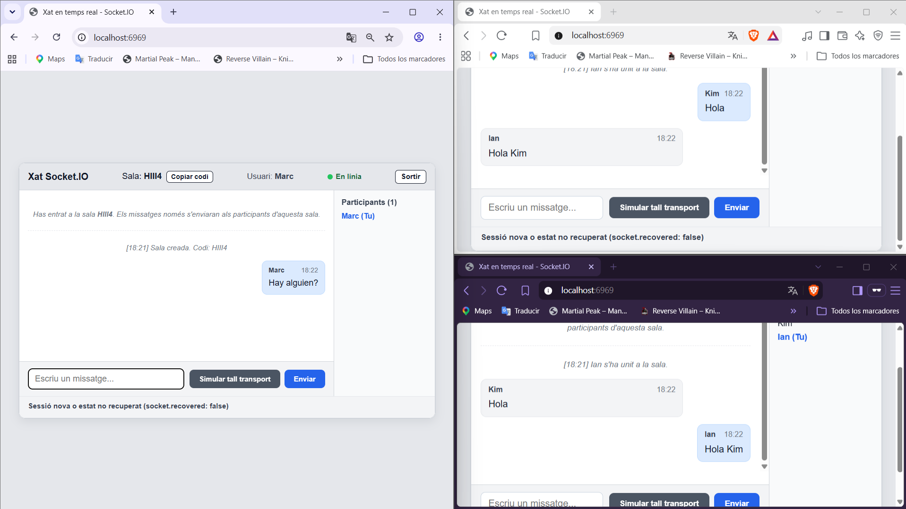

# Xat en Temps Real amb Socket.IO

Aquest projecte és una aplicació de xat en temps real desenvolupada amb **Node.js**, **Express**, **Socket.IO**, HTML5 i Vanilla CSS. Permet la comunicació bidireccional instantània entre múltiples usuaris sense recarregar la pàgina ni realitzar peticions periòdiques (polling).

---

## 🚀 Instruccions d'Instal·lació i Execució

### 1. Prerequisits
- Tenir instal·lat **Node.js** (v16 o superior).

### 2. Instal·lació de dependències
Executa la següent comanda a l'arrel del projecte per instal·lar les dependències registrades a `package.json`:
```bash
npm install
```

### 3. Arrencar el servidor
Per iniciar el servidor Node:
```bash
npm start
```
*(També es pot executar directament amb `node server.js`)*

### 4. Accedir a l'aplicació
Obre una o més pestanyes del navegador i accedeix a:
```
http://localhost:6969
```

---

## 📋 Respostes a les Preguntes Teòriques

### 1. Quin esdeveniment envia el client i quin rep?
* **Envia (client → servidor):**
  * `room:create`: Envia el nom d'usuari per crear una nova sala privada.
  * `room:join`: Envia el nom d'usuari i el codi de la sala per unir-s'hi.
  * `room:leave`: Sol·licita abandonar la sala activa actual.
  * `chat:send`: Envia el text del missatge destinat a la sala activa.
* **Rep (servidor → client / sala):**
  * `room:joined`: Confirma l'entrada a la sala amb `{ roomId, username }`.
  * `room:left`: Confirma que l'usuari ha sortit de la sala.
  * `room:error`: Notifica un error de sala (nom invàlid, codi inexistent o tancat).
  * `room:participants`: Emet a tots els membres de la sala la llista actualitzada de participants.
  * `chat:message`: Rep els missatges (d'usuaris o de sistema) enviats exclusivament dins de la sala.
  * `chat:error`: Notifica un error en enviar un missatge (missatge buit, massa llarg o no pertinença a cap sala).

### 2. Quina diferència hi ha, al servidor, entre `socket.emit()`, `io.emit()` i `io.to(room).emit()`?
* **`socket.emit('event', data)`**: Envia l'esdeveniment exclusivament al client connectat a través d'aquell sòcol específic (comunicació privada 1 a 1 entre client i servidor).
* **`io.emit('event', data)`**: Realitza una difusió global (*broadcast*) a **tots** els clients connectats actualment a la instància del servidor de Socket.IO, sense distinció de sales.
* **`io.to(room).emit('event', data)`**: Envia l'esdeveniment de manera segmentada exclusivament als sockets que s'han unit a la sala especificada (`room`). Cap client fora d'aquesta sala no rebrà el paquet.

### 3. Per què no és suficient validar les dades només al formulari?
Perquè les validacions del costat del client (HTML5, JavaScript al navegador) s'executen en un entorn que està completament sota el control de l'usuari. Qualsevol persona pot saltar-se-les desactivant JavaScript, modificant els atributs del DOM des de les eines de desenvolupador (DevTools) o enviant esdeveniments de WebSocket directament mitjançant scripts o consoles.  
La validació al servidor és imprescindible perquè el servidor és l'únic entorn de confiança que pot garantir la seguretat, integritat i compliment de límits (longitud màxima, camps obligatoris, caràcters permesos) abans de processar les dades.

---

## ⚡ Ampliacions Realitzades

### Ampliació 1: Desconnexions i recuperació d'estat (`connectionStateRecovery`)
S'ha configurat Socket.IO al servidor amb l'opció `connectionStateRecovery` amb una finestra temporal de recuperació de 2 minuts (120.000 ms):
```javascript
const io = new Server(server, {
    connectionStateRecovery: {
        maxDisconnectionDuration: 2 * 60 * 1000
    }
});
```

Al client:
* S'ha configurat `reconnectionDelay: 10000`, `reconnectionDelayMax: 10000` i `randomizationFactor: 0`.
* S'ha afegit un botó **"Simular tall transport"** que crida exactament a `socket.io.engine.close()`, simulant una caiguda de transport sense desconnexió voluntària.
* Es verifica estrictament el valor booleà de **`socket.recovered`** en reconnectar:
  * Si `socket.recovered === true`: Mostra clarament que la sessió i l'estat s'han recuperat amb èxit.
  * Si `socket.recovered === false`: Mostra que es tracta d'una sessió nova o que no s'ha pogut recuperar l'estat.

#### Taula comparativa de recuperació de connexió

| Escenari de prova | Comportament dels missatges durant el tall | Valor de `socket.recovered` | Explicació tècnica |
|---|---|---|---|
| **Sense recuperació activada** | Els missatges enviats per altres clients mentre la pestanya estava desconnectada **es perden** per a aquest client. | `undefined` / `false` | El servidor no reté un buffer de paquets per a aquesta connexió; en tornar, comença una sessió neta sense historial intermedi. |
| **Amb `connectionStateRecovery` activat** | Els missatges enviats durant la caiguda **es recuperen automàticament** en restablir el transport. | `true` | L'adaptador de Socket.IO emmagatzema a la memòria temporal els esdeveniments pendents de la sessió durant la finestra de 2 minuts i els reenvia al restablir el transport. |
| **Després de reiniciar el servidor Node** | Els missatges enviats abans o durant el reinici **es perden** i no es reben. | `false` | Com que s'utilitza l'adaptador en memòria per defecte (*InMemoryAdapter*), la memòria RAM del procés Node s'esborra en reiniciar-se. Es crea una nova instància i es descarten les sessions prèvies. |

---

### Ampliació 2: Sales i Participants (`Rooms` i `socket.data`)

Aquesta ampliació permet crear converses independents en sales privades identificades amb un codi de 5 caràcters alfanumèrics únics.

#### 1. Requisits implementats
1. **Creació de sales:** L'usuari introdueix el seu nom i prem «Crear Sala Nova». El servidor genera un codi únic (ex: `AB39K`), crea la sala i hi uneix el socket. A la capçalera de la sala s'inclou un botó per copiar ràpidament el codi al porta-retalls.
2. **Unió a sales existents:** L'usuari introdueix el seu nom i el codi d'una sala existent. Si el codi no existeix o la sala s'ha tancat, el servidor respon amb un missatge d'error clar.
3. **Una sola sala activa per usuari:** El servidor assegura que cada socket només està associat a una sala activa alhora (`socket.data.roomId`). Si un usuari canvia de sala o en crea una de nova, abandona automàticament la sala anterior. A més, pot prémer «Abandonar sala» en qualsevol moment.
4. **Aïllament de missatges:** Els missatges s'emeten amb `io.to(roomId).emit('chat:message', message)` garantint que només arriben als membres d'aquella sala.
5. **Llista de participants en temps real:** Es mostra una barra lateral amb els participants actius i el seu recompte. Aquesta llista s'actualitza immediatament quan algú s'uneix, surt voluntàriament o tanca la pestanya/es desconnecta. L'usuari actual apareix identificat amb el distintiu `(Tu)`.
6. **Validació al servidor:** El servidor valida tant la integritat del nom com l'existència i format del codi de sala i dels missatges.

#### 2. Detalls Tècnics i Funcionament Intern

* **Com sap el servidor el nom i sala de cada client?**  
  Utilitzem la propietat oficial de Socket.IO `socket.data`:
  ```javascript
  socket.data.username = cleanName;
  socket.data.roomId = cleanRoom;
  ```
* **Diferència entre esdeveniments `disconnecting` i `disconnect`:**  
  Durant l'esdeveniment `disconnecting`, la propietat `socket.rooms` encara conté les sales a les quals pertany el client. Això permet que el servidor identifiqui la sala activa, notifiqui als companys que l'usuari s'ha desconnectat i actualitzi la llista abans que el socket sigui destruït de l'adaptador. A `disconnect`, en canvi, `socket.rooms` ja està completament buit.
* **Què passa quan una sala queda buida?**  
  Quan l'últim usuari surt o es desconnecta d'una sala (`io.sockets.adapter.rooms.get(roomId)` és buit o té mida 0), el servidor elimina el registre d'`activeRooms`. D'aquesta manera s'alliberen recursos a la memòria RAM i cap client nou pot accedir a una sala fantasma sense participants.
* **Separació entre peticions de client i notificacions del servidor:**  
  * **Peticions de client:** `room:create`, `room:join`, `room:leave`, `chat:send`.
  * **Respostes unívoques al client:** `room:joined`, `room:left`, `room:error`, `chat:error`.
  * **Notificacions col·lectives a la sala:** `room:participants` (actualització de membres) i `chat:message` (missatges de xat i avisos del sistema com "Kim s'ha unit a la sala").

---

## 🧪 Proves de Comprovació i Captures de Pantalla

A continuació es mostren les evidències gràfiques de les proves realitzades amb 3 pestanyes simultànies, verificant el compliment de tots els requisits de l'Ampliació 2:

### 📸 Prova 1: Entrada dels usuaris i selecció de sales
Tres usuaris diferents introdueixen els seus noms (`Kim`, `Ian` i `Marc`). `Kim` crea una nova sala privada per compartir-la amb `Ian`, i `Marc` es crea una altra sala independent.


---

### 📸 Prova 2: Unió a les sales i llistes de participants independents
S'observa com a la sala creada per `Kim` s'hi uneix `Ian` introduint el codi, de manera que tots dos queden registrats a la mateixa sala (`Participants: 2`). Mentrestant, `Marc` es troba aïllat a la seva pròpia sala (`Participants: 1`).


---

### 📸 Prova 3: Aïllament complet de converses entre sales
`Kim` i `Ian` s'envien missatges mútuament dins la seva sala. Es comprova que aquests missatges **no arriben** a la sala d'en `Marc`. `Marc` pot escriure i parlar a la seva sala sense rebre ni interferir en la conversa dels altres dos usuaris.



---

### 📸 Prova 4: Desconnexió en temps real i actualització de participants
La pestanya d'`Ian` es tanca. Immediatament, al xat de la sala d'en `Kim` es mostra la notificació de sistema indicant que `Ian` s'ha desconnectat, i el comptador de participants s'actualitza automàticament restant-ne un.


