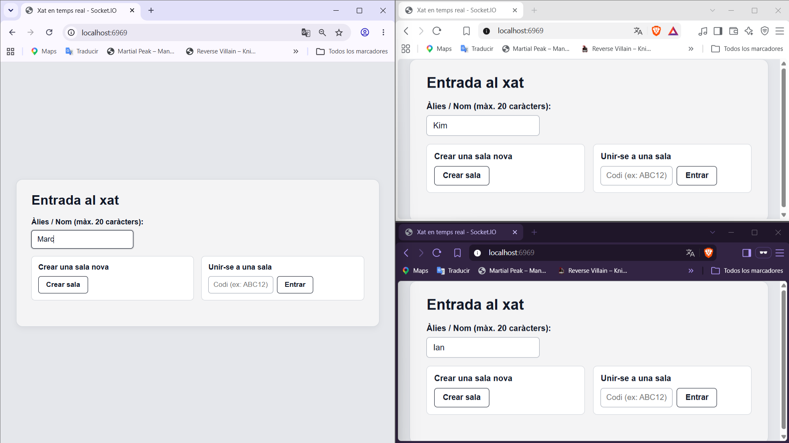
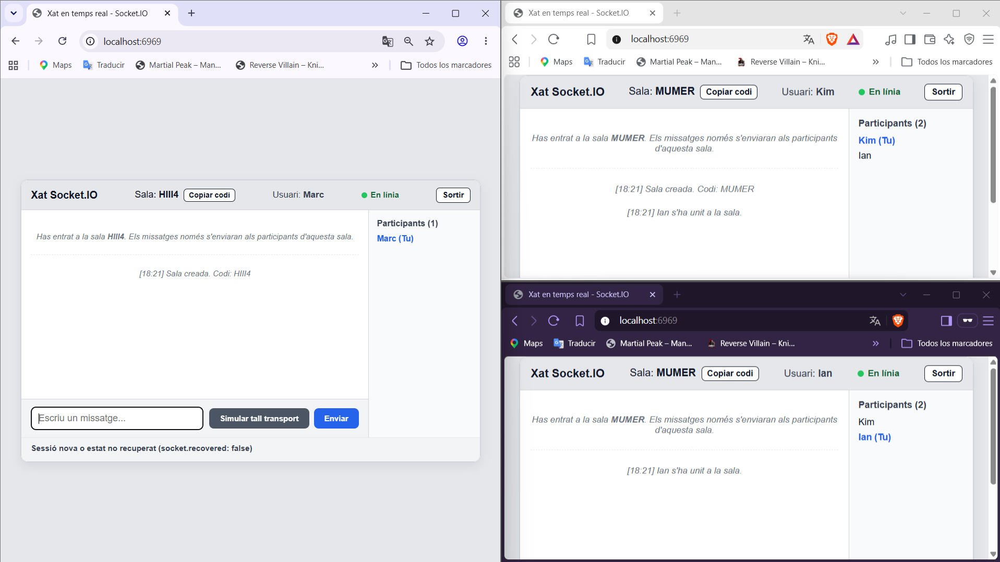
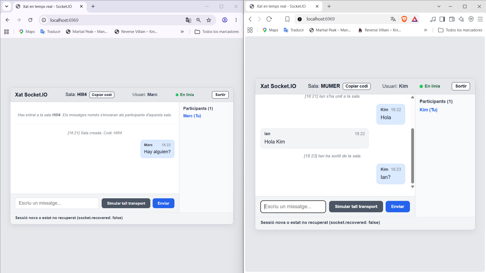
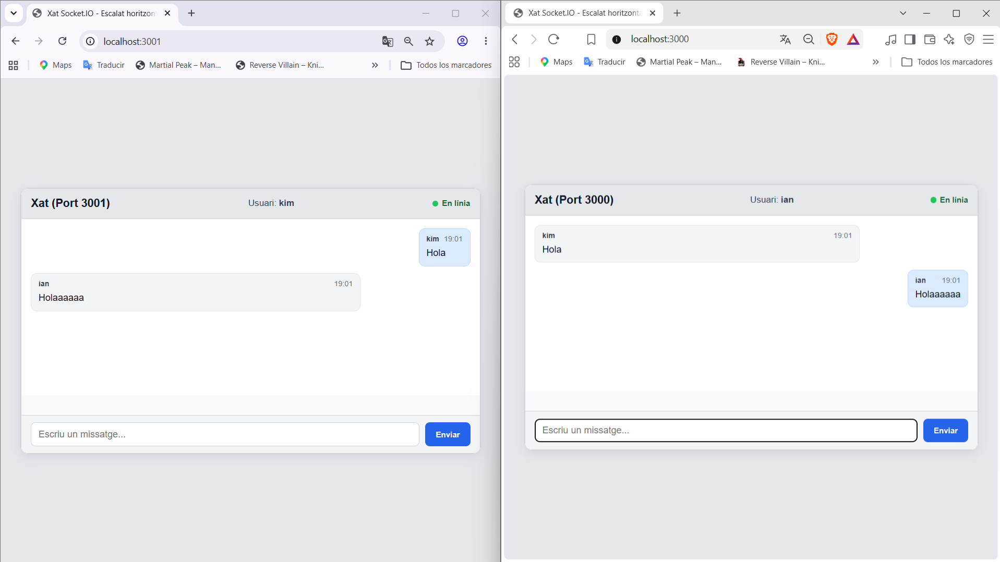

# Xat en Temps Real amb Socket.IO

Aquest projecte és una aplicació de xat en temps real desenvolupada amb **Node.js**, **Express**, **Socket.IO**, HTML5 i Vanilla CSS. Permet la comunicació bidireccional instantània entre múltiples usuaris sense recarregar la pàgina ni realitzar peticions periòdiques (polling).

---

## 🌿 Estructura del Repositori i Entrega per Branques

Per mantenir el codi net, modular i respectar les particularitats de cada ampliació (com la incompatibilitat de `connectionStateRecovery` amb el clúster multi-procés o l'arquitectura exclusiva de sales), el projecte s'organitza en **3 branques Git**:

| Branca | Contingut de l'Entrega | Com accedir al codi complet |
|---|---|---|
| **`main`** *(Actual)* | **Entrega principal**: Codi base del xat + **Ampliació 1** (`connectionStateRecovery`). Inclou aquest README central amb totes les respostes teòriques i les evidències gràfiques de totes les ampliacions. | Branca per defecte |
| **`sales`** | **Ampliació 2**: Codi complet de sales privades amb codis únics de 5 caràcters, aïllament de missatges i llista de participants en temps real (`socket.data`). | `git checkout sales` |
| **`escalat-horitzontal`** | **Ampliació 3**: Codi complet d'escalat horitzontal amb `node:cluster`, 2 treballadors en ports `3000` i `3001`, i sincronització via `@socket.io/cluster-adapter`. | `git checkout escalat-horitzontal` |

> 📌 **Nota per a l'avaluació:** A continuació es detalla l'explicació tècnica i les **captures de pantalla de prova** de totes les ampliacions realitzades. Si es desitja provar o inspeccionar el codi font complet de l'Ampliació 2 o 3, només cal canviar a la seva branca respectiva mitjançant `git checkout <nom-de-branca>`.

---

## 🚀 Instruccions d'Instal·lació i Execució (Branca `main`)

### 1. Prerequisits
- Tenir instal·lat **Node.js** (v16 o superior).

### 2. Instal·lació de dependències
Executa la següent comanda a l'arrel del projecte per instal·lar les dependències registrades a `package.json`:
```bash
npm install
```

### 3. Arrencar el servidor
Per iniciar el servidor Node:
```bash
npm start
```
*(També es pot executar directament amb `node server.js`)*

### 4. Accedir a l'aplicació
Obre una o més pestanyes del navegador i accedeix a:
```
http://localhost:6969
```

---

## 📋 Respostes a les Preguntes Teòriques Generals

### 1. Quin esdeveniment envia el client i quin rep?
* **Envia (client → servidor):**
  * `join-chat`: Envia el nom/àlies de l'usuari triat per a la sessió.
  * `chat:send`: Envia l'objecte amb el nom de l'usuari i el text del missatge.
* **Rep (servidor → client):**
  * `join-success`: Confirma que el nom és vàlid i permet entrar al xat.
  * `join-error`: Notifica que el nom no compleix els criteris de validació.
  * `chat:message`: Rep el missatge validat i difós pel servidor (amb `id`, `username`, `text` i `time`).
  * `chat:error`: Notifica un error si el missatge enviat no supera les validacions del servidor.

### 2. Quina diferència hi ha, al servidor, entre `socket.emit()` i `io.emit()`?
* **`socket.emit('event', data)`**: Envia l'esdeveniment exclusivament al client connectat a través d'aquell sòcol específic (comunicació privada 1 a 1 entre client i servidor).
* **`io.emit('event', data)`**: Realitza una difusió global (*broadcast*) a **tots** els clients connectats actualment a la instància del servidor de Socket.IO.
* *(A la branca `sales`)* **`io.to(room).emit('event', data)`**: Realitza una difusió segmentada exclusivament als sockets que s'han unit a aquella sala concreta.

### 3. Per què no és suficient validar les dades només al formulari?
Perquè les validacions del costat del client (HTML5, JavaScript al navegador) s'executen en un entorn que està completament sota el control de l'usuari. Qualsevol persona pot saltar-se-les desactivant JavaScript, modificant els atributs del DOM des de les eines de desenvolupador (DevTools) o enviant esdeveniments de WebSocket directament mitjançant scripts o consoles.  
La validació al servidor és imprescindible perquè el servidor és l'únic entorn de confiança que pot garantir la seguretat, integritat i compliment de límits (longitud màxima, camps obligatoris, caràcters permesos) abans de processar les dades.

---

## ⚡ Ampliació 1: Desconnexions i Recuperació d'Estat (`connectionStateRecovery`)
> 📁 **Codi disponible a:** Branca actual (`main`)

S'ha configurat Socket.IO al servidor amb l'opció `connectionStateRecovery` amb una finestra temporal de recuperació de 2 minuts (120.000 ms):
```javascript
const io = new Server(server, {
    connectionStateRecovery: {
        maxDisconnectionDuration: 2 * 60 * 1000
    }
});
```

Al client:
* S'ha configurat `reconnectionDelay: 10000`, `reconnectionDelayMax: 10000` i `randomizationFactor: 0`.
* S'ha afegit un botó **"Simular tall transport"** que crida exactament a `socket.io.engine.close()`, simulant una caiguda de transport sense desconnexió voluntària.
* Es verifica estrictament el valor booleà de **`socket.recovered`** en reconnectar:
  * Si `socket.recovered === true`: Mostra clarament que la sessió i l'estat s'han recuperat amb èxit.
  * Si `socket.recovered === false`: Mostra que es tracta d'una sessió nova o que no s'ha pogut recuperar l'estat.

### Taula comparativa de recuperació de connexió

| Escenari de prova | Comportament dels missatges durant el tall | Valor de `socket.recovered` | Explicació tècnica |
|---|---|---|---|
| **Sense recuperació activada** | Els missatges enviats per altres clients mentre la pestanya estava desconnectada **es perden** per a aquest client. | `undefined` / `false` | El servidor no reté un buffer de paquets per a aquesta connexió; en tornar, comença una sessió neta sense historial intermedi. |
| **Amb `connectionStateRecovery` activat** | Els missatges enviats durant la caiguda **es recuperen automàticament** en restablir el transport. | `true` | L'adaptador de Socket.IO emmagatzema a la memòria temporal els esdeveniments pendents de la sessió durant la finestra de 2 minuts i els reenvia al restablir el transport. |
| **Després de reiniciar el servidor Node** | Els missatges enviats abans o durant el reinici **es perden** i no es reben. | `false` | Com que s'utilitza l'adaptador en memòria per defecte (*InMemoryAdapter*), la memòria RAM del procés Node s'esborra en reiniciar-se. Es crea una nova instància i es descarten les sessions prèvies. |

---

## ⚡ Ampliació 2: Sales i Participants (`Rooms` i `socket.data`)
> 📁 **Codi complet disponible a la branca:** `sales`  
> Per canviar a aquesta branca i provar el codi:
> ```bash
> git checkout sales
> npm start
> ```

Aquesta ampliació permet crear converses independents en sales privades identificades amb un codi de 5 caràcters alfanumèrics únics.

### 1. Funcionalitats Implementades
1. **Creació de sales:** L'usuari introdueix el seu nom i prem «Crear Sala Nova». El servidor genera un codi únic de 5 caràcters (ex: `AB39K`), crea la sala i hi uneix el socket. S'inclou un botó ràpid per copiar el codi al porta-retalls.
2. **Unió a sales existents:** L'usuari introdueix el seu nom i el codi d'una sala existent. Si el codi no existeix o la sala s'ha tancat, el servidor respon amb missatge d'error clar.
3. **Una sola sala activa per usuari:** El servidor assegura que cada socket només està associat a una sala activa alhora (`socket.data.roomId`). Si un usuari canvia de sala o en crea una de nova, abandona automàticament la sala anterior. També pot prémer «Abandonar sala» en qualsevol moment.
4. **Aïllament de missatges:** Els missatges s'emeten amb `io.to(roomId).emit('chat:message', message)`, garantint que només arriben als membres d'aquella sala.
5. **Llista de participants en temps real:** Es mostra una barra lateral amb els participants actius i el seu recompte. S'actualitza immediatament quan algú entra, surt o es desconnecta. L'usuari actual apareix identificat amb `(Tu)`.
6. **Gestió del cicle de vida:** Utilització de l'esdeveniment `disconnecting` per recuperar `socket.rooms` abans de la destrucció del socket, i neteja automàtica de sales buides a la memòria del servidor.

### 2. Evidències Gràfiques de les Proves (Captures de Pantalla)

Les proves es van realitzar amb **3 pestanyes simultànies** comprovant tots els fluxos:

#### 📸 Prova 1: Entrada dels usuaris i selecció de sales
Tres usuaris diferents introdueixen els seus noms (`Kim`, `Ian` i `Marc`). `Kim` crea una nova sala privada per compartir-la amb `Ian`, i `Marc` es crea una altra sala independent.



---

#### 📸 Prova 2: Unió a les sales i llistes de participants independents
S'observa com a la sala creada per `Kim` s'hi uneix `Ian` introduint el codi, de manera que tots dos queden registrats a la mateixa sala (`Participants: 2`). Mentrestant, `Marc` es troba aïllat a la seva pròpia sala (`Participants: 1`).



---

#### 📸 Prova 3: Aïllament complet de converses entre sales
`Kim` i `Ian` s'envien missatges mútuament dins la seva sala. Es comprova que aquests missatges **no arriben** a la sala d'en `Marc`. `Marc` pot escriure i parlar a la seva sala sense rebre ni interferir en la conversa dels altres dos usuaris.


---

#### 📸 Prova 4: Desconnexió en temps real i actualització de participants
La pestanya d'`Ian` es tanca. Immediatament, al xat de la sala d'en `Kim` es mostra la notificació de sistema indicant que `Ian` s'ha desconnectat, i el comptador de participants s'actualitza automàticament restant-ne un.



---

## ⚡ Ampliació 3: Escalat Horitzontal (`node:cluster` i `@socket.io/cluster-adapter`)
> 📁 **Codi complet disponible a la branca:** `escalat-horitzontal`  
> Per canviar a aquesta branca i provar el codi:
> ```bash
> git checkout escalat-horitzontal
> node server.js
> ```

Aquesta ampliació implementa l'escalat horitzontal en múltiples processos de Node.js utilitzant el mòdul natiu `node:cluster` i l'adaptador `@socket.io/cluster-adapter`, tal com s'especifica al Pas 9 del tutorial oficial de Socket.IO.

### 1. Configuració de Processos Treballadors
El procés primari (`cluster.isPrimary`) bifurca dos processos treballadors (*workers*):
- **Treballador 1**: Escolta al port `3000` (PID independent).
- **Treballador 2**: Escolta al port `3001` (PID independent).

Cada pestanya del navegador es connecta directament a un port (`http://localhost:3000` o `http://localhost:3001`), sense requerir cap balancejador de càrrega intermedi.

### 2. Demostració en Dues Fases

* **Fase 1 (Sense adaptador - Processos aïllats):**  
  Sense `createAdapter()`, un missatge enviat al port 3000 es queda a la memòria d'aquell procés i **no arriba** a la pestanya connectada al port 3001.
* **Fase 2 (Amb adaptador `@socket.io/cluster-adapter`):**  
  Amb `setupPrimary()` al procés mestre i `adapter: createAdapter()` als workers, els missatges s'intercanvien a través del canal IPC natiu de Node.js i es retransmeten instantàniament a tots els clients de tots els ports.

### 3. Evidència Gràfica de Funcionament

A la captura següent es pot observar la prova realitzada amb dues pestanyes connectades a ports diferents (`Ian` al port `3000` i `Kim` al port `3001`). Es verifica com els missatges s'entreguen immediatament entre processos amb PIDs diferents gràcies a l'adaptador de clúster:



### 4. Preguntes Teòriques de l'Ampliació 3

#### Per què dos processos Node.js no comparteixen automàticament la memòria?
Node.js s'executa sobre el motor JavaScript V8 en un model d'un sol fil d'execució (*single thread*) per procés. Quan utilitzem `node:cluster`, es creen processos fills independents mitjançant crides al sistema operatiu (`fork`). Cada procés té el seu propi espai d'adreçament de memòria virtual totalment protegit i aïllat pel kernel del sistema operatiu. Per tant, els objectes, variables, connexions de sòcols i col·leccions en memòria que existeixen en el procés del port 3000 són completament inaccessibles per al procés del port 3001.

#### Què aporta l'adaptador (`@socket.io/cluster-adapter`)?
Per defecte, Socket.IO emmagatzema les connexions i sales a la memòria del procés (`InMemoryAdapter`). En un entorn de clúster, un missatge emès amb `io.emit()` només arribaria als clients connectats a aquell procés concret.  
`@socket.io/cluster-adapter` resol aquest problema aprofitant el canal de comunicació entre processos (**IPC** - *Inter-Process Communication*) natiu de Node.js:
1. Al procés primari s'inicialitza `setupPrimary()`.
2. A cada procés fill s'assigna `createAdapter()`.
3. Quan qualsevol treballador fa un `io.emit()`, l'adaptador intercepta el paquet i l'envia via IPC al procés primari, el qual el retransmet immediatament a tots els altres treballadors. Cada treballador rep el paquet i el transmet als seus respectius clients connectats.

#### Per què no cal desplegar un balancejador en aquesta pràctica?
Un balancejador de càrrega (com Nginx o HAProxy) és necessari quan hi ha múltiples servidors escoltant darrere d'una única adreça pública/port (per exemple el port 80 o 443), requerint *sticky sessions* perquè les peticions d'un mateix client vagin sempre al mateix procés.  
En aquesta pràctica, assignem manualment ports diferents a cada procés (`3000` i `3001`). Com que cada pestanya del navegador s'obre directament contra el port del procés desitjat (`http://localhost:3000` o `http://localhost:3001`), la connexió ja està dirigida manualment i no es requereix cap encaminament intermedi.

#### Quina és la relació entre `@socket.io/cluster-adapter` i `connectionStateRecovery`?
Tal com s'indica a la documentació oficial de Socket.IO, `@socket.io/cluster-adapter` **no té suport actualment per a `connectionStateRecovery`**. Aquesta funcionalitat requereix un magatzem compartit capaç de guardar un buffer persistent dels missatges transmesos durant la desconnexió (com ara l'adaptador basat en Redis Streams o MongoDB). Per aquesta raó, l'ampliació de recuperació de connexió i l'ampliació de difusió multi-procés s'han avaluat de manera independent.

---

## 🎥 Vídeos Demostratius (Pràctica Base i Ampliació 1)

> 💡 **Espai per a vídeos:** A continuació es preparen els apartats per a enllaçar o incrustar els vídeos demostratius enregistrats per a la pràctica base i l'Ampliació 1. (En editar el fitxer des del web de GitHub, només cal arrossegar els fitxers de vídeo `.mp4` o `.mov` dins de cada secció perquè GitHub generi l'enllaç i reproductor automàticament).

### 📹 Vídeo 1: Demostració del Xat Base en Temps Real
[Fes clic aquí per veure el vídeo de la pràctica base a YouTube](https://www.youtube.com/watch?v=AAJIWIB4S2A)

---

### 📹 Vídeo 2: Demostració de l'Ampliació 1 (Recuperació d'Estat i Desconnexions)
[Fes clic aquí per veure el vídeo de l'Ampliació 1 a YouTube](https://www.youtube.com/watch?v=1aYW4geFcv4)

